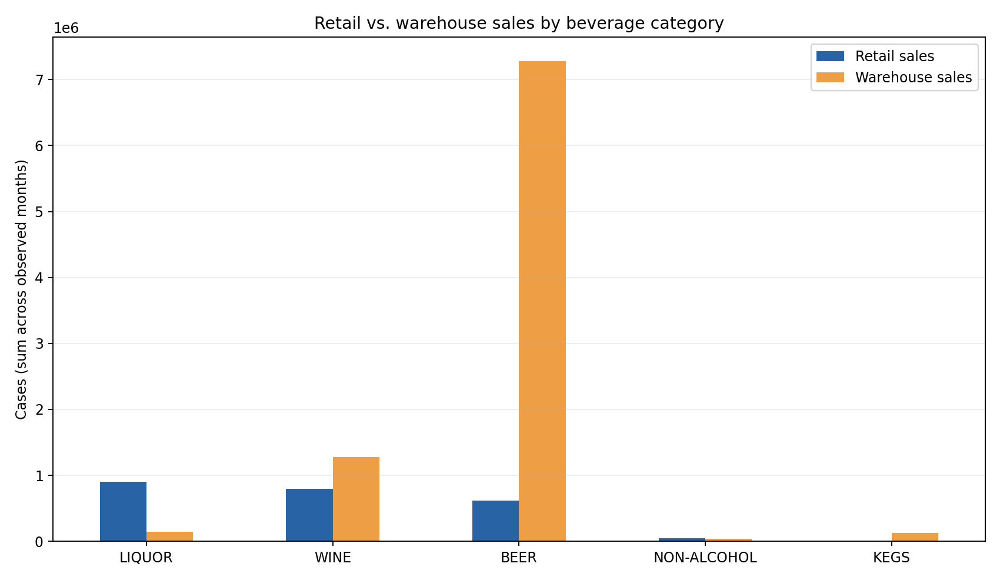
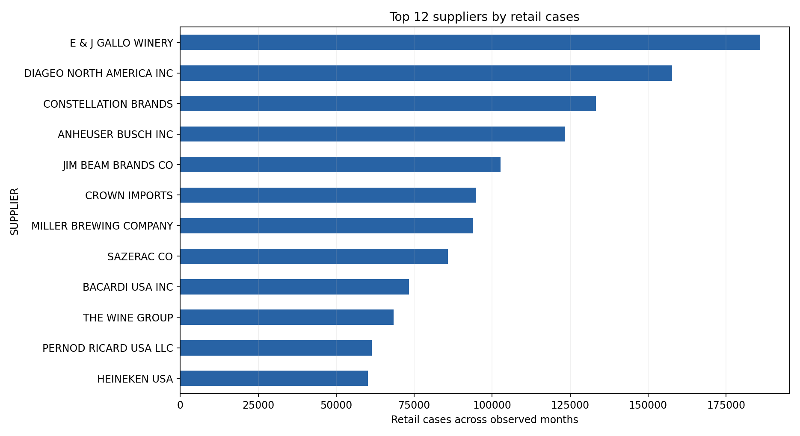
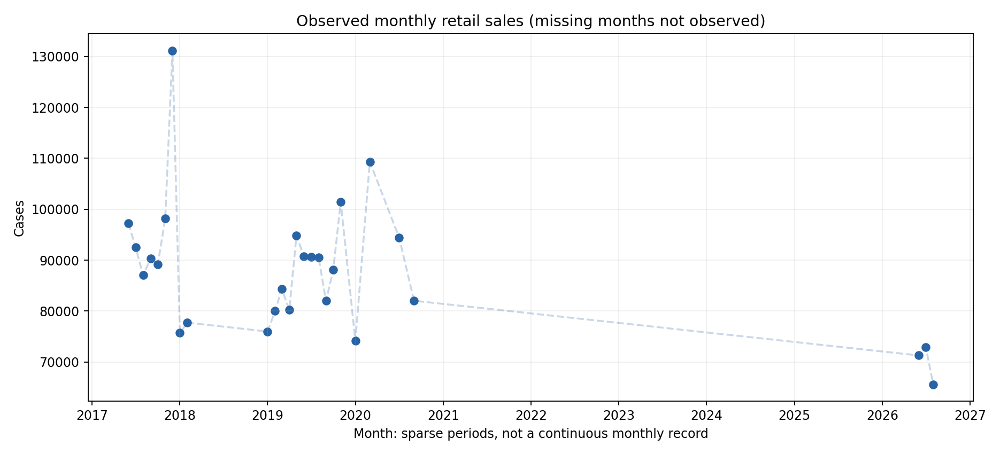
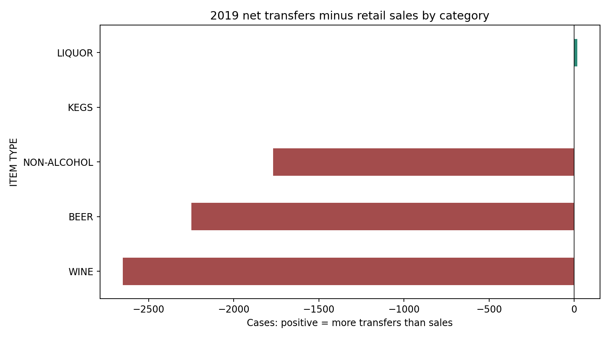
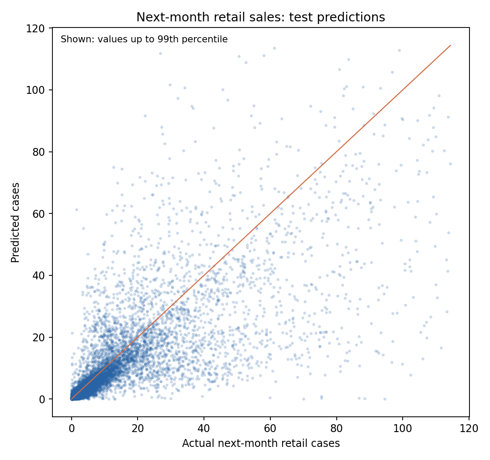
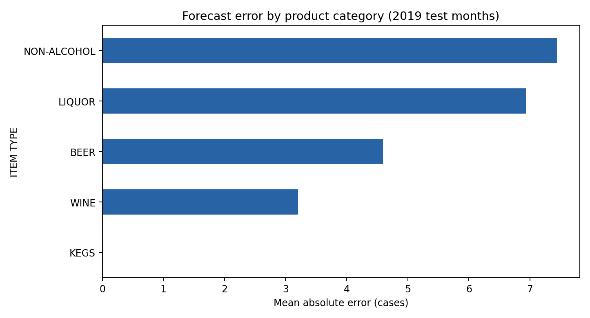

# Montgomery County Warehouse & Retail Sales Analysis

**Business Analytics Final Group Project — Lenoir\-Rhyne University**

This project analyzes warehouse and retail case sales for alcoholic beverages in Montgomery County, Maryland\. It examines product and supplier performance, retail distribution alignment, and next\-month retail sales prediction\.

## Research Questions

1. **Product and supplier performance:** Which beverage categories, products, and suppliers account for the largest volumes of retail and warehouse sales?
2. **Retail distribution alignment:** How closely do transfers to retail stores align with actual retail sales?
3. **Sales prediction:** Can historical retail sales, retail transfers, warehouse sales, and product characteristics predict next\-month retail sales?

## Dataset

**Source:** [Montgomery County Open Data — Warehouse and Retail Sales](https://data.montgomerycountymd.gov/d/v76h-r7br)

- **Total records:** 341,037
- **Coverage:** 27 observed months across 2017, 2018, 2019, 2020, and 2026; this is **not** a continuous time series\.
- **Measures:** `RETAIL SALES`, `RETAIL TRANSFERS`, and `WAREHOUSE SALES` are measured in **cases, not dollars**\.
- **Key fields:** Year, month, supplier, item code, item description, and item type\.

The data is provided in two parts because of GitHub browser upload limits:

- [Dataset — Part 1](warehouse_retail_part_1.csv)
- [Dataset — Part 2](warehouse_retail_part_2.csv)

The files have identical headers and can be combined using a **union** in Tableau &#40;not a join&#41;\. Together they contain the 341,037 original records\.

## Methodology

The analysis examines category and supplier sales volumes, monthly changes, and differences between transfers and retail sales\. For the predictive investigation, consecutive\-month item records from 2019 are used to evaluate a multiple linear regression against a simple previous\-month\-sales baseline\.

Numeric fields were cleaned to handle commas, missing values, and negative adjustments\. Interpretation accounts for gaps in available months and operational categories that may not represent ordinary consumer demand\.

[Read the full Data and Method documentation](Data_and_Method.md)\.

## Key Findings

- **Liquor** accounts for approximately **38\.2%** of observed beverage retail cases\.
- **E & J Gallo Winery** is the leading retail supplier by case volume in the analyzed extract\.
- The total 2019 beverage **transfer\-minus\-retail\-sales gap** is approximately **\-6,651 cases**\. This difference does not directly measure inventory on hand\.
- The regression achieved a held\-out **mean absolute error &#40;MAE&#41; of 4\.22 cases** and **root mean squared error &#40;RMSE&#41; of 18\.73 cases**, compared with a previous\-month baseline MAE of **4\.45** and RMSE of **19\.03** cases\.

These results describe case volumes, not sales revenue, profit, or causal relationships\.

## Visualizations

### 1\. Beverage Category Sales

### 2\. Leading Retail Suppliers

### 3\. Monthly Sales Trends

### 4\. Retail Transfers Versus Sales

### 5\. Actual Versus Predicted Retail Sales

### 6\. Regression Error by Product Category

## Supporting Analysis Files

- [2019 transfer\-sales differences](2019_transfer_sales_gap.csv)
- [Monthly totals](monthly_totals.csv)
- [Sales by category](sales_by_category.csv)
- [Top suppliers](top_15_suppliers.csv)
- [Regression test predictions](regression_test_predictions.csv)
- [Model error by category](model_error_by_category.csv)

## Business Case Report

[Read the Business Case Report](Business_Case_Report.md) for project objectives, findings, business implications, limitations, and recommendations\.

## Tableau Note

The PNG visualizations in this repository were recreated from the project data for publication; they are not exports of the original Tableau workbook\. If required by the instructor, the Tableau packaged workbook &#40;`.twbx`&#41; or dashboard screenshots should be submitted separately\.

## Project Limitations

- The dataset reports quantities in cases, not revenue or profitability\.
- Several calendar months are missing from the export; trend and seasonality comparisons are limited\.
- Negative adjustments and special operational item types require careful interpretation\.
- Regression results are predictive, not evidence of causation\.

## Submission

This public repository contains the dataset, visualizations, supporting analysis, and business report for the Business Analytics final group project\.
